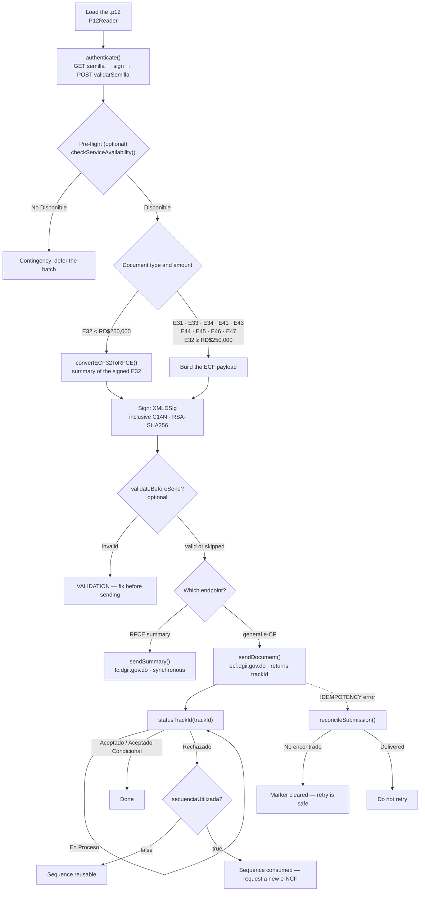
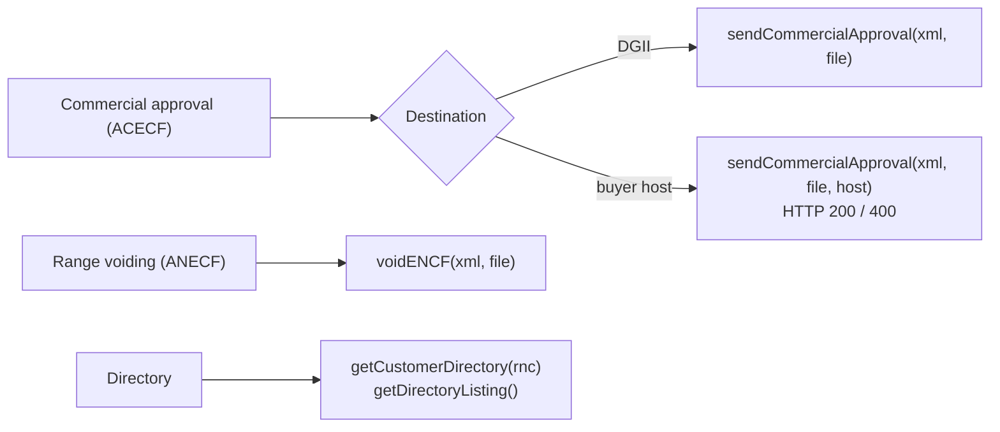

# End-to-end flow

The API reference lists what each method does. This page shows **the order to
call them in** — the part that is easy to get wrong and expensive to debug.

Every step below matches the official DGII documents; the normative reference
is [`project-docs/dgii-ground-truth.md`](https://github.com/deuriib/dgii-ecf/blob/main/project-docs/dgii-ground-truth.md).

## The main flow



## 1. Authenticate

DGII issues a seed, you sign it with the certificate, and exchange it for a
bearer token.

=== "TypeScript"

    ```ts
    import { ECF, Environment, P12Reader } from '@deuriib/dgii-ecf';

    const credentials = new P12Reader(passphrase).getKeyFromFile('cert.p12');
    if (credentials.isErr()) throw credentials.error;

    const ecf = new ECF(credentials.value, Environment.Prod);
    const auth = await ecf.authenticate();
    if (auth.isErr()) throw auth.error;
    ```

=== "Python"

    ```python
    from py_dgii_ecf import ECF, Environment, P12Reader

    credentials = P12Reader(passphrase).get_key_from_file("cert.p12")
    if credentials.is_err():
        raise RuntimeError(credentials.unwrap_err())

    ecf = ECF(credentials.unwrap(), Environment.PROD)
    auth = ecf.authenticate()
    if auth.is_err():
        raise RuntimeError(auth.unwrap_err())
    ```

The token is valid for **one hour**. Both clients refresh it shortly before it
expires and re-authenticate once on a `401`, so a long-running worker does not
need to manage it.

## 2. Pre-flight (optional)

Before a batch, ask whether the services are up and whether the environment is
inside a maintenance window. This needs the status API key, not the token.

=== "TypeScript"

    ```ts
    import { StatusEnvironment } from '@deuriib/dgii-ecf';

    const status = await ecf.checkServiceAvailability(StatusEnvironment.Production);
    if (status.isOk() && status.value.estado === 'No Disponible') {
      // Inside a maintenance window: defer the batch.
    }
    ```

=== "Python"

    ```python
    from py_dgii_ecf import StatusEnvironment

    status = ecf.check_service_availability(StatusEnvironment.PRODUCTION)
    if status.is_ok() and status.unwrap().estado == "No Disponible":
        ...  # Inside a maintenance window: defer the batch.
    ```

The client needs `statusApiKey` / `status_api_key` for this call.

## 3. Route by document type and amount

This is the decision most integrators get wrong.

| Document                                    | Endpoint      | Host              | Response           |
| ------------------------------------------- | ------------- | ----------------- | ------------------ |
| E32 **below** RD$250,000                    | `recepcionfc` | `fc.dgii.gov.do`  | synchronous result |
| E32 **at or above** RD$250,000              | `recepcion`   | `ecf.dgii.gov.do` | `trackId`          |
| E31, E33, E34, E41, E43, E44, E45, E46, E47 | `recepcion`   | `ecf.dgii.gov.do` | `trackId`          |

A consumption invoice below the threshold is **not** sent as-is: DGII only
accepts the RFCE summary for it, and the summary is built from the already
signed E32.

=== "TypeScript"

    ```ts
    import { convertECF32ToRFCE } from '@deuriib/dgii-ecf';

    const converted = convertECF32ToRFCE(signedEcf);
    if (converted.isErr()) throw converted.error;
    // converted.value.xml   -> sign it as RFCE
    // converted.value.securityCode -> CodigoSeguridadeCF
    ```

=== "Python"

    ```python
    from py_dgii_ecf import convert_ecf32_to_rfce

    converted = convert_ecf32_to_rfce(signed_ecf)
    if converted.is_err():
        raise RuntimeError(converted.unwrap_err())
    payload = converted.unwrap()
    # payload["xml"]          -> sign it as RFCE
    # payload["securityCode"] -> CodigoSeguridadeCF
    ```

`sendDocument` / `send_document` applies this routing for you and rejects an
E32 below the threshold instead of misrouting it.

## 4. Sign

Sign **last**, and never reformat the document afterwards — the signature covers
the exact bytes.

=== "TypeScript"

    ```ts
    import { Signature } from '@deuriib/dgii-ecf';

    const signer = new Signature(credentials.value.key!, credentials.value.cert!);
    const signed = signer.signXml(xml, 'ECF'); // or 'RFCE', 'ACECF', 'ANECF'
    if (signed.isErr()) throw signed.error;
    ```

=== "Python"

    ```python
    from py_dgii_ecf import Signature

    signer = Signature(credentials.unwrap().key, credentials.unwrap().cert)
    signed = signer.sign_xml(xml, "ECF")  # or "RFCE", "ACECF", "ANECF"
    if signed.is_err():
        raise RuntimeError(signed.unwrap_err())
    ```

## 5. Submit

=== "TypeScript"

    ```ts
    const response = await ecf.sendDocument(signed.value, `${rnc}${encf}.xml`);
    if (response.isErr()) throw response.error;
    // general e-CF: { trackId }
    // RFCE summary: { codigo, estado, encf, secuenciaUtilizada }
    ```

=== "Python"

    ```python
    response = ecf.send_document(signed.unwrap(), f"{rnc}{encf}.xml")
    if response.is_err():
        raise RuntimeError(response.unwrap_err())
    ```

Submissions are **idempotent**, keyed on `RNC + e-NCF + SHA-256(signed XML)`.
A repeated call returns the cached result instead of issuing a second document.

## 6. Track the result

A general e-CF is acknowledged with a `trackId`; the fiscal verdict arrives
asynchronously.

=== "TypeScript"

    ```ts
    let status = await ecf.statusTrackId(response.value.trackId!);
    while (status.isOk() && status.value.estado === 'En Proceso') {
      await new Promise((resolve) => setTimeout(resolve, 2_000));
      status = await ecf.statusTrackId(response.value.trackId!);
    }
    ```

=== "Python"

    ```python
    import time

    status = ecf.status_track_id(response.unwrap().track_id)
    while status.is_ok() and status.unwrap().estado == "En Proceso":
        time.sleep(2)
        status = ecf.status_track_id(response.unwrap().track_id)
    ```

| `codigo` | `estado`             | Meaning                            |
| -------- | -------------------- | ---------------------------------- |
| 0        | No encontrado        | DGII has no record of the track id |
| 1        | Aceptado             | Valid for tax purposes             |
| 2        | Rechazado            | Not valid — see `mensajes`         |
| 3        | En Proceso           | Still validating; keep polling     |
| 4        | Aceptado Condicional | Valid with observations            |

On a rejection, `secuenciaUtilizada` decides the next step: `false` means the
e-NCF may be reused, `true` means it is consumed and a new one is required.

## 7. Reconcile a pending submission

If the process dies mid-send, the idempotency marker stays **pending** and the
next attempt returns `IDEMPOTENCY` rather than re-sending. Resolve it before
retrying:

=== "TypeScript"

    ```ts
    const outcome = await ecf.reconcileSubmission(signed.value);
    if (outcome.isOk() && outcome.value.cleared) {
      // DGII has no record: the retry is safe.
    }
    ```

=== "Python"

    ```python
    outcome = ecf.reconcile_submission(signed.unwrap())
    if outcome.is_ok() and outcome.unwrap().cleared:
        ...  # DGII has no record: the retry is safe.
    ```

The marker is cleared only when DGII reports `No encontrado`. If DGII has the
document, the marker stays and `delivered` is `true` — do not retry.

## Auxiliary flows



- **ACECF to DGII** returns `{ codigo, estado }`: `codigo` is `"1"` or `"2"`.
- **ACECF to a buyer** returns `{ status, accepted }`. A `400` means the buyer
  received and rejected it — the issuer must then answer with an E34.
- **ANECF** only voids sequences that were never sent to DGII nor delivered to
  the buyer. Anything already issued needs an E34.
- **Directory** gives you `urlRecepcion`, `urlAceptacion` and `urlOpcional` for a
  given RNC, which is what the B2B flow uses.

## Common mistakes

| Mistake                                                 | Consequence                                                   |
| ------------------------------------------------------- | ------------------------------------------------------------- |
| Sending an E32 below RD$250,000 to the general endpoint | Rejected — it must go as an RFCE summary                      |
| Signing, then reformatting or re-indenting the XML      | Invalid signature                                             |
| Reusing a consumed e-NCF                                | Rejected — check `secuenciaUtilizada`                         |
| Retrying a pending submission without reconciling       | `IDEMPOTENCY`, or a duplicate if the store is bypassed        |
| Treating `Ok(...)` as "accepted"                        | A 200 can carry `error` populated; the verdict is in `estado` |
| Delivering an E41/E43/E45/E46/E47 straight to a buyer   | DGII excludes those types from the B2B flow                   |
