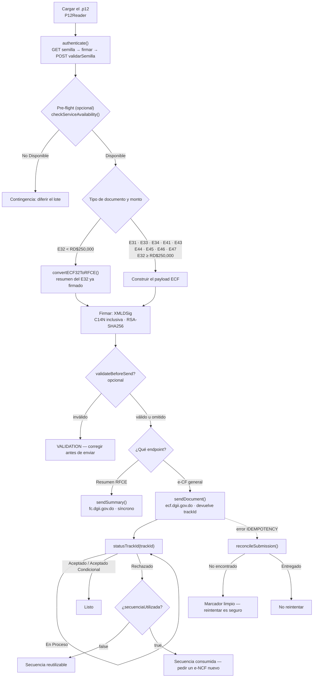
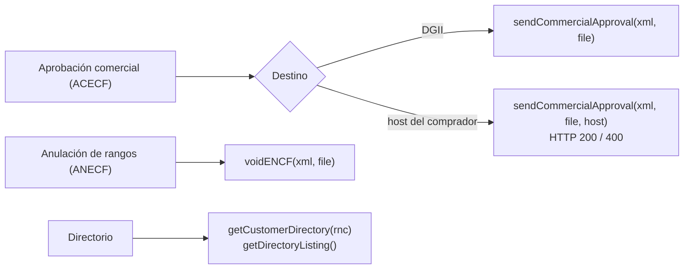

# Flujo de extremo a extremo

La referencia de API lista qué hace cada método. Esta página muestra **el orden
en que hay que llamarlos** — la parte fácil de equivocar y cara de depurar.

Cada paso coincide con los documentos oficiales de la DGII; la referencia
normativa es [`project-docs/dgii-ground-truth.md`](https://github.com/deuriib/dgii-ecf/blob/main/project-docs/dgii-ground-truth.md).

## El flujo principal



## 1. Autenticarse

La DGII emite una semilla, la firmas con el certificado y la canjeas por un
token bearer.

=== "TypeScript"

    ```ts
    import { ECF, Environment, P12Reader } from '@deuriib/dgii-ecf';

    const credentials = new P12Reader(passphrase).getKeyFromFile('cert.p12');
    if (credentials.isErr()) throw credentials.error;

    const ecf = new ECF(credentials.value, Environment.Prod);
    const auth = await ecf.authenticate();
    if (auth.isErr()) throw auth.error;
    ```

=== "Python"

    ```python
    from py_dgii_ecf import ECF, Environment, P12Reader

    credentials = P12Reader(passphrase).get_key_from_file("cert.p12")
    if credentials.is_err():
        raise RuntimeError(credentials.unwrap_err())

    ecf = ECF(credentials.unwrap(), Environment.PROD)
    auth = ecf.authenticate()
    if auth.is_err():
        raise RuntimeError(auth.unwrap_err())
    ```

El token dura **una hora**. Ambos clientes lo refrescan poco antes de vencer y
se re-autentican una vez ante un `401`, así que un worker de larga duración no
tiene que gestionarlo.

## 2. Pre-flight (opcional)

Antes de un lote, pregunta si los servicios están arriba y si el ambiente está
dentro de una ventana de mantenimiento. Requiere la API key de status, no el
token.

=== "TypeScript"

    ```ts
    import { StatusEnvironment } from '@deuriib/dgii-ecf';

    const status = await ecf.checkServiceAvailability(StatusEnvironment.Production);
    if (status.isOk() && status.value.estado === 'No Disponible') {
      // Ventana de mantenimiento: diferir el lote.
    }
    ```

=== "Python"

    ```python
    from py_dgii_ecf import StatusEnvironment

    status = ecf.check_service_availability(StatusEnvironment.PRODUCTION)
    if status.is_ok() and status.unwrap().estado == "No Disponible":
        ...  # Ventana de mantenimiento: diferir el lote.
    ```

El cliente necesita `statusApiKey` / `status_api_key` para esta llamada.

## 3. Enrutar por tipo de documento y monto

Esta es la decisión que más se equivoca.

| Documento                                   | Endpoint      | Host              | Respuesta          |
| ------------------------------------------- | ------------- | ----------------- | ------------------ |
| E32 **menor** a RD$250,000                  | `recepcionfc` | `fc.dgii.gov.do`  | resultado síncrono |
| E32 **igual o mayor** a RD$250,000          | `recepcion`   | `ecf.dgii.gov.do` | `trackId`          |
| E31, E33, E34, E41, E43, E44, E45, E46, E47 | `recepcion`   | `ecf.dgii.gov.do` | `trackId`          |

Una factura de consumo bajo el umbral **no** se envía tal cual: la DGII solo
acepta el resumen RFCE, y el resumen se construye a partir del E32 ya firmado.

=== "TypeScript"

    ```ts
    import { convertECF32ToRFCE } from '@deuriib/dgii-ecf';

    const converted = convertECF32ToRFCE(signedEcf);
    if (converted.isErr()) throw converted.error;
    // converted.value.xml          -> firmarlo como RFCE
    // converted.value.securityCode -> CodigoSeguridadeCF
    ```

=== "Python"

    ```python
    from py_dgii_ecf import convert_ecf32_to_rfce

    converted = convert_ecf32_to_rfce(signed_ecf)
    if converted.is_err():
        raise RuntimeError(converted.unwrap_err())
    payload = converted.unwrap()
    # payload["xml"]          -> firmarlo como RFCE
    # payload["securityCode"] -> CodigoSeguridadeCF
    ```

`sendDocument` / `send_document` aplica este ruteo por ti y rechaza un E32 bajo
el umbral en vez de enrutarlo mal.

## 4. Firmar

Firma **al final**, y nunca reformatees el documento después — la firma cubre
los bytes exactos.

=== "TypeScript"

    ```ts
    import { Signature } from '@deuriib/dgii-ecf';

    const signer = new Signature(credentials.value.key!, credentials.value.cert!);
    const signed = signer.signXml(xml, 'ECF'); // o 'RFCE', 'ACECF', 'ANECF'
    if (signed.isErr()) throw signed.error;
    ```

=== "Python"

    ```python
    from py_dgii_ecf import Signature

    signer = Signature(credentials.unwrap().key, credentials.unwrap().cert)
    signed = signer.sign_xml(xml, "ECF")  # o "RFCE", "ACECF", "ANECF"
    if signed.is_err():
        raise RuntimeError(signed.unwrap_err())
    ```

## 5. Enviar

=== "TypeScript"

    ```ts
    const response = await ecf.sendDocument(signed.value, `${rnc}${encf}.xml`);
    if (response.isErr()) throw response.error;
    // e-CF general: { trackId }
    // resumen RFCE: { codigo, estado, encf, secuenciaUtilizada }
    ```

=== "Python"

    ```python
    response = ecf.send_document(signed.unwrap(), f"{rnc}{encf}.xml")
    if response.is_err():
        raise RuntimeError(response.unwrap_err())
    ```

Los envíos son **idempotentes**, con clave `RNC + e-NCF + SHA-256(XML firmado)`.
Una llamada repetida devuelve el resultado cacheado en vez de emitir un segundo
documento.

## 6. Consultar el resultado

Un e-CF general se acusa con un `trackId`; el veredicto fiscal llega de forma
asíncrona.

=== "TypeScript"

    ```ts
    let status = await ecf.statusTrackId(response.value.trackId!);
    while (status.isOk() && status.value.estado === 'En Proceso') {
      await new Promise((resolve) => setTimeout(resolve, 2_000));
      status = await ecf.statusTrackId(response.value.trackId!);
    }
    ```

=== "Python"

    ```python
    import time

    status = ecf.status_track_id(response.unwrap().track_id)
    while status.is_ok() and status.unwrap().estado == "En Proceso":
        time.sleep(2)
        status = ecf.status_track_id(response.unwrap().track_id)
    ```

| `codigo` | `estado`             | Significado                            |
| -------- | -------------------- | -------------------------------------- |
| 0        | No encontrado        | La DGII no tiene registro del track id |
| 1        | Aceptado             | Válido para fines tributarios          |
| 2        | Rechazado            | No válido — ver `mensajes`             |
| 3        | En Proceso           | Sigue validando; continuar consultando |
| 4        | Aceptado Condicional | Válido con observaciones               |

Ante un rechazo, `secuenciaUtilizada` decide el siguiente paso: `false` significa
que el e-NCF puede reutilizarse, `true` que está consumido y hace falta uno nuevo.

## 7. Reconciliar un envío pendiente

Si el proceso muere a mitad del envío, el marcador de idempotencia queda
**pendiente** y el siguiente intento devuelve `IDEMPOTENCY` en vez de reenviar.
Resuélvelo antes de reintentar:

=== "TypeScript"

    ```ts
    const outcome = await ecf.reconcileSubmission(signed.value);
    if (outcome.isOk() && outcome.value.cleared) {
      // La DGII no tiene registro: reintentar es seguro.
    }
    ```

=== "Python"

    ```python
    outcome = ecf.reconcile_submission(signed.unwrap())
    if outcome.is_ok() and outcome.unwrap().cleared:
        ...  # La DGII no tiene registro: reintentar es seguro.
    ```

El marcador se limpia solo cuando la DGII responde `No encontrado`. Si la DGII
tiene el documento, el marcador se mantiene y `delivered` es `true` — no
reintentes.

## Flujos auxiliares



- **ACECF a la DGII** devuelve `{ codigo, estado }`: `codigo` es `"1"` o `"2"`.
- **ACECF a un comprador** devuelve `{ status, accepted }`. Un `400` significa
  que el comprador lo recibió y lo rechazó — el emisor debe responder entonces
  con una E34.
- **ANECF** solo anula secuencias que nunca se enviaron a la DGII ni se
  entregaron al comprador. Lo ya emitido necesita una E34.
- **Directorio** te da `urlRecepcion`, `urlAceptacion` y `urlOpcional` para un
  RNC, que es lo que usa el flujo B2B.

## Errores comunes

| Error                                                  | Consecuencia                                              |
| ------------------------------------------------------ | --------------------------------------------------------- |
| Enviar un E32 bajo RD$250,000 al endpoint general      | Rechazado — debe ir como resumen RFCE                     |
| Firmar y luego reformatear o reindentar el XML         | Firma inválida                                            |
| Reutilizar un e-NCF consumido                          | Rechazado — revisar `secuenciaUtilizada`                  |
| Reintentar un envío pendiente sin reconciliar          | `IDEMPOTENCY`, o duplicado si se salta el store           |
| Tratar `Ok(...)` como "aceptado"                       | Un 200 puede traer `error`; el veredicto está en `estado` |
| Entregar un E41/E43/E45/E46/E47 directo a un comprador | La DGII excluye esos tipos del flujo B2B                  |
